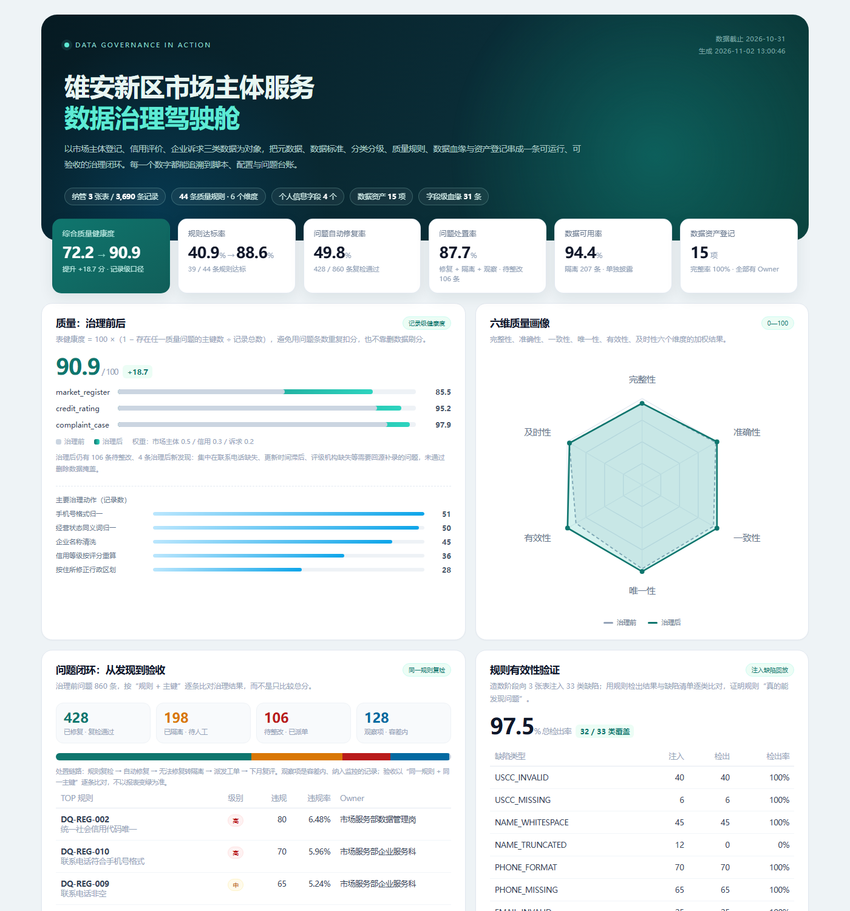

# 作品展示 · 数据治理在行动

> 面向**数据治理工程师**岗位的一页式作品说明。
> 项目：雄安新区市场主体服务数据治理；角色：独立设计与开发；形式：可运行、可复现、可验收。

## 一句话介绍

我独立设计并实现了一套面向市场主体服务场景的数据治理闭环：把 3 张业务表、3,690 条数据从“能存”治理到“可用、可信、可共享”，并用 44 条质量规则、记录级评分、问题工单和复检验收证明治理效果。

## 关键结果

| 维度 | 结果 |
| --- | --- |
| 质量 | 综合健康度 **72.20 → 90.91**（+18.71）；规则达标率 **40.9% → 88.6%** |
| 闭环 | 治理前 860 条问题；自动修复 428 条、隔离 198 条（涉及 207 条记录）、待整改 106 条、观察 128 条 |
| 可用性 | 隔离 207 条，数据可用率 **94.4%**，隔离数据单独披露，不靠删数据刷分 |
| 规则有效性 | 注入 33 类、833 条缺陷，规则检出率 **97.5%**，并明确 1 类语义缺陷未覆盖 |
| 安全 | 29 个字段 100% 分类分级；正文命中 150 行个人信息；脱敏共享残留 **0** 处 |
| 资产 | 登记 15 项数据资产，完整率 100%，全部明确 Owner 与共享属性 |
| 血缘 | 21 个节点、31 条字段级映射，可查询字段变更影响 |
| 工程 | 零第三方依赖，一条命令约 1 秒跑完；CI 每次重跑并做 6 条验收断言 |

## 我做了什么

1. **把 JD 翻译成可执行对象**
   将“数据目录、标准、分类分级、质量、血缘、资产”拆成 8 份配置和 11 个 Python 模块，每条职责都能对应到代码、报告和指标。
2. **设计可验证的造数方案**
   固定随机种子生成 3 张业务表，按类型注入 33 类缺陷并保存清单；这样质量规则不是“自说自话”，而是可以计算检出率。
3. **设计记录级质量评分**
   以“存在任一问题的主键数 ÷ 记录总数”计算表健康度，按业务重要性加权；同时单独披露规则达标率、数据可用率，避免单一指标误导。
4. **把整改做成闭环**
   治理前问题逐条记录规则、主键、Owner、SLA、整改建议；治理后按“同一规则 + 同一主键”复检，标记已修复 / 已隔离 / 待整改 / 观察项，并计算自动修复率和处置率。
5. **做字段级 + 内容级安全治理**
   对 29 个字段分级；对 12345 诉求正文做手机号、身份证号、邮箱、银行卡号识别；生成脱敏共享文件后再次扫描，确认 0 残留。
6. **做可展示的工程产物**
   自动生成质量报告、治理月报、数据目录、分类分级报告、资产台账、血缘图、5 个指标和一页式驾驶舱；驾驶舱为单文件 HTML，离线可打开，也可发布到 GitHub Pages。

## 为什么这不是一个“玩具项目”

- **有治理对象**：不是拿一份干净 CSV 做图表，而是先定义标准、目录、分级，再清洗和评分；
- **有治理机制**：有组织、RACI、制度、流程、KPI、SLA 和整改验收，不是只有代码；
- **有可验证性**：缺陷注入清单 + 规则检出率 + 同主键复检，能证明“规则真的有效、问题真的修了”；
- **有真实取舍**：保留 106 条待整改、198 条隔离、1 类未覆盖缺陷，并解释为什么不能靠治理层“改数”解决；
- **有复用价值**：配置驱动，更换业务域只需替换标准、规则、码表和造数脚本；模板可直接用于实习/工作。

## 与岗位 JD 的对应

| JD 要求 | 我的证据 |
| --- | --- |
| 建立治理体系、制度流程、责任机制 | `docs/01` 组织/RACI/制度/流程/KPI；`config/governance.json` |
| 数据目录、元数据、标准、分类分级、血缘 | 自动采集 6 张表 / 61 个字段；29 字段标准；字段级 + 内容级分级；31 条字段映射 |
| 质量规则、监测评估、问题定位、整改验收 | 44 条 SQL 规则；860 条问题台账；复检验收；规则检出率 97.5% |
| 清洗、标准化、平台配置、资产登记 | 去重/码值/日期/手机号/区划修复；207 条隔离；15 项资产登记 |
| 方法沉淀、质量报告、行业模板 | 质量报告 + 治理月报 + 5 类模板；配置驱动复用 |
| SQL / Python | 44 条 SQL 规则；Python 标准库实现 11 个模块，零依赖 |
| 个人信息保护 | L1-L4 分级、4 类内容识别器、脱敏共享、残留 0、共享审批流程 |

## 如果只有 3 分钟，我会这样讲

1. **背景（20 秒）**：市场主体服务有登记、信用、诉求三类数据，问题是标准不统一、联系方式缺失、诉求正文含个人信息、出了问题找不到责任人。
2. **做法（60 秒）**：先建标准和目录，再跑 44 条规则做基线；能自动修的修（手机号、状态、区划、信用等级），不能修的隔离；然后按同一规则复检，形成带 Owner 和 SLA 的整改台账；最后做分级脱敏、资产登记和血缘。
3. **结果（40 秒）**：健康度 72.2 到 90.9，规则达标率 40.9% 到 88.6%，860 条问题里 428 条自动修复、198 条隔离、106 条待整改；规则对注入缺陷检出 97.5%，脱敏残留 0。
4. **反思（40 秒）**：治理后仍有 106 条待整改，主要依赖源系统补录；企业名称截断这类语义问题规则识别不了，需要人工抽检或外部核验。这说明治理不是一次性项目，而是持续运营。
5. **收尾（20 秒）**：项目零依赖、一条命令可复现，所有数字来自脚本；代码、报告、模板都在仓库里。

## 简历表述（可直接改用）

- 独立设计并实现市场主体服务数据治理项目，覆盖 3 张表 / 3,690 条记录 / 29 个标准字段，构建元数据、标准、分类分级、质量、血缘、资产六位一体治理闭环。
- 设计 44 条 SQL 质量规则与记录级评分模型，治理后综合健康度由 72.20 提升至 90.91，规则达标率由 40.9% 提升至 88.6%。
- 建立“发现—定位—派单—整改—复检”闭环，输出 860 条带 Owner/SLA 的问题台账，自动修复 428 条、隔离 198 条，治理后保留 106 条待整改并持续跟踪。
- 通过缺陷注入清单验证规则有效性，33 类缺陷检出率 97.5%；识别并脱敏 150 行诉求正文中的个人信息，共享文件残留 0 处。
- 基于配置自动生成字段级血缘（31 条映射）与 15 项数据资产台账，支持字段变更影响分析；项目零第三方依赖，CI 全流程重跑并验收。

## 面试可能被追问

| 问题 | 回答要点 |
| --- | --- |
| 为什么质量分不用“问题数/总行数”？ | 同一条记录多个字段出错会重复扣分；记录级只扣一次，更接近“可用记录占比”。 |
| 为什么隔离而不是直接删除？ | 删除会让分母变小、分数虚高；隔离保留证据，单独披露可用率，并进入人工整改。 |
| 怎么证明规则有效？ | 造数时注入已知缺陷并记录清单，逐类计算检出率；未覆盖的语义缺陷如实披露。 |
| 90.91 为什么没到 95？ | 剩余问题集中在电话缺失、更新滞后、评级机构缺失，必须回源补录；治理层不能伪造数据。 |
| 分类分级怎么做？ | 字段规则 + 内容正则两层；字段级覆盖 29 个字段，内容级扫描 12345 正文，脱敏后再扫残留。 |
| 血缘怎么保证不漂移？ | 字段映射来自转换配置，表级拓扑来自血缘配置；CI 校验映射完整性，变更前跑 impact。 |
| 如果数据量到 TB 级？ | 当前 SQLite 是沙箱；生产可换 Spark/数仓，规则 SQL 与评分逻辑可平移，元数据接 DataHub/Atlas。 |
| 你最大的不足？ | 语义质量、真实平台集成、权限网关还没做；已在 Roadmap 中列出，并说明优先级。 |

更完整的 JD 对照和 10 分钟讲法见 [`docs/08-岗位JD映射与面试讲解.md`](docs/08-岗位JD映射与面试讲解.md)。

## 链接

- 仓库：<https://github.com/Ganqi-pp/data-governance-in-action>
- 在线驾驶舱：<https://ganqi-pp.github.io/data-governance-in-action/>
- 质量报告：[`reports/quality_report.md`](reports/quality_report.md)
- 治理月报：[`reports/governance_report.md`](reports/governance_report.md)
- 数据资产台账：[`reports/asset_register.md`](reports/asset_register.md)
- 数据血缘：[`reports/lineage.md`](reports/lineage.md)
