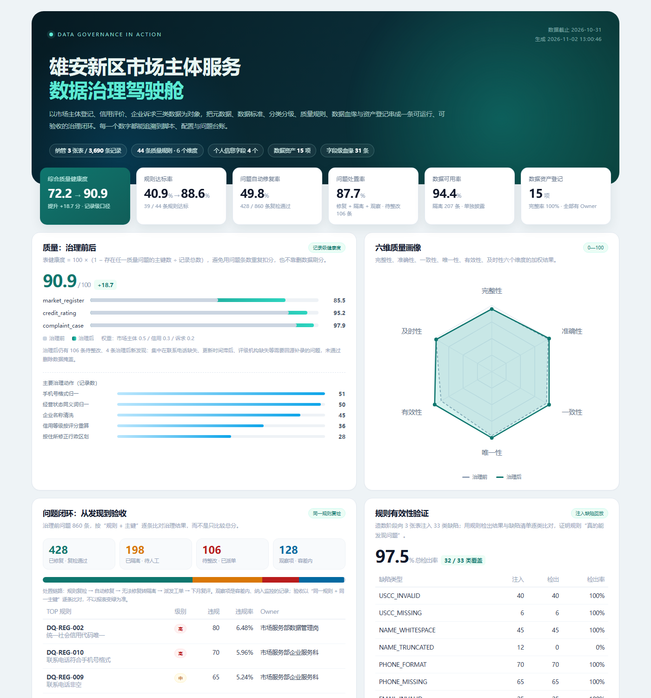
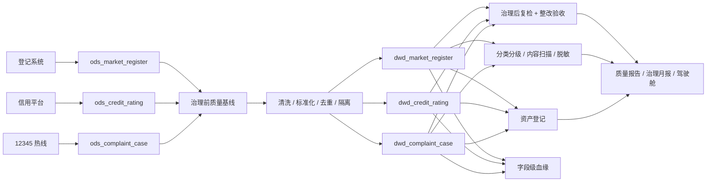

# 数据治理在行动 · 雄安新区市场主体服务

> 一个**在校生独立完成**、可直接运行的数据治理项目：把市场主体登记、信用评价、企业诉求三类数据，做成一条从元数据、标准、分类分级、质量、血缘到资产登记的完整治理闭环。
>
> 项目围绕**国家数据集团数据治理工程师**岗位 JD 设计，重点不是“画架构图”，而是把每条职责落到可执行代码、可核验数字和可复用模板上。

[](https://github.com/Ganqi-pp/data-governance-in-action/actions/workflows/ci.yml)


**在线作品**：[治理驾驶舱](https://ganqi-pp.github.io/data-governance-in-action/) ·
[质量报告](reports/quality_report.md) ·
[治理月报](reports/governance_report.md) ·
[数据资产台账](reports/asset_register.md)



## 一分钟看结果

| 指标 | 结果 |
| --- | --- |
| 治理范围 | 3 张核心表 / 29 个标准字段 / 3,690 条记录 |
| 质量规则 | **44 条**，覆盖完整性、准确性、一致性、唯一性、有效性、及时性 |
| 综合质量健康度 | **72.20 → 90.91**（+18.71） |
| 规则达标率 | **40.9% → 88.6%** |
| 问题整改 | 治理前 860 条；自动修复 428 条，隔离 198 条（涉及 207 条记录），待整改 106 条，观察 128 条 |
| 数据可用率 | 94.4%（隔离 207 条，单独披露，不参与质量分） |
| 规则有效性 | 对注入的 33 类缺陷检出 **97.5%**（32/33 类覆盖） |
| 分类分级 | 29 个字段 100% 覆盖；识别个人信息字段 4 个；正文命中 150 行 |
| 脱敏共享 | 2 个共享文件，个人信息残留 **0** 处 |
| 数据资产 | 15 项，登记完整率 100%，全部明确 Owner |
| 数据血缘 | 21 个节点、31 条字段级映射，支持变更影响分析 |
| 运行方式 | **零第三方依赖**，`python run_demo.py` 约 1 秒跑完 |

> 数字全部由脚本从固定种子的模拟数据实时计算，没有手工填写。数据为虚构内容，不对应任何真实企业或个人。

## 为什么做这个项目

岗位 JD 要求的是“能建立体系、能落标准、能查质量、能推整改、能沉淀模板”的复合能力。多数学生项目只做“数据清洗 + 可视化”，缺少三样东西：

1. **治理对象**：没有数据目录、标准、分类分级，清洗没有依据；
2. **治理闭环**：发现了问题，但没有工单、责任人、SLA 和复检验收；
3. **可验证性**：报告说“质量提升”，却无法证明规则真的能发现问题。

这个项目用一套很小的数据（3 张表、3,690 行）把这三件事补齐，并刻意保留“治理后仍不完美”的真实状态：有 106 条待整改、198 条隔离、1 类语义缺陷规则覆盖不了。**治理不是把报表刷绿，而是把问题说清楚、把责任落下去、把改进可追踪。**

## 与岗位 JD 的对应关系

| JD 职责 | 本项目实现 | 可核验证据 |
| --- | --- | --- |
| 建立数据治理体系、制度流程和责任机制 | 治理章程、组织架构、RACI、6 项制度、5 条运行流程、6 个 KPI | [`docs/01`](docs/01-数据治理体系与组织.md)、[`config/governance.json`](config/governance.json) |
| 组织数据目录、元数据、数据标准、分类分级和数据血缘建设 | 自动采集表/字段/行数/空值率/基数；29 字段标准；字段级 + 内容级分级；字段级血缘 | [`reports/data_catalog.md`](reports/data_catalog.md)、[`reports/classification_report.md`](reports/classification_report.md)、[`reports/lineage.md`](reports/lineage.md) |
| 制定质量规则，开展监测评估、问题定位和整改验收 | 44 条 SQL 规则；记录级健康度；问题定位到主键；同规则复检验收；整改台账带 Owner/SLA | [`reports/quality_report.md`](reports/quality_report.md)、[`reports/issue_register.csv`](reports/issue_register.csv)、[`reports/rule_effectiveness.csv`](reports/rule_effectiveness.csv) |
| 推进数据清洗、标准化转换、治理平台配置及数据资产登记 | 去重、码值归一、日期/手机号/区划修复、隔离区；15 项资产登记；共享脱敏导出 | [`src/dgov/cleanse.py`](src/dgov/cleanse.py)、[`reports/asset_register.md`](reports/asset_register.md) |
| 沉淀治理方法、质量报告和行业模板，推动能力复用 | 质量/治理月报模板、整改工单、资产登记、分类分级、制度模板；配置驱动可换域复用 | [`templates/`](templates/)、[`reports/governance_report.md`](reports/governance_report.md) |
| 熟悉数据治理、标准、元数据、质量、安全方法 | 标准编号体系、GB 32100 校验、GB/T 4754 码表、GB/T 43697 分级、个人信息保护措施 | [`docs/02`](docs/02-数据标准规范.md)、[`docs/03`](docs/03-数据分类分级与个人信息保护.md) |
| 能用 SQL、Python 开展治理工作 | 44 条规则全部落到 SQLite SQL；Python 标准库实现采集、清洗、评分、报告、看板 | [`src/dgov/`](src/dgov/)、[`sql/`](sql/) |

更细的“JD 条目 → 代码/产物 → 面试讲法”见 [`docs/08-岗位JD映射与面试讲解.md`](docs/08-岗位JD映射与面试讲解.md)。

## 治理闭环



实现顺序固定、可重跑：造数 → 装载 → 标准检查 → 质量基线 → 清洗隔离 → 元数据 → 分类分级 → 复检验收 → 血缘/资产/指标 → 报告/看板。

## 项目亮点

1. **记录级质量分，而不是“问题数除以总行数”**
   同一条记录多个字段出错只扣一次，避免重复扣分；表权重按业务重要性设置。公式和反模式都写在报告里。
2. **不靠删数据刷分**
   无法修复的数据进入隔离区（如信用代码校验失败、关键日期非法），隔离率 5.6% 单独披露；治理后仍有 106 条待整改。
3. **规则有效性可证明**
   造数阶段注入 833 条、33 类缺陷，并记录缺陷清单；报告逐类计算检出率（97.5%），并明确 1 类语义缺陷未覆盖，不假装 100%。
4. **整改验收是“同一规则 + 同一主键”复检**
   不是比较总分，而是逐条判断“已修复 / 已隔离 / 待整改 / 观察项”，并输出带 Owner、SLA、整改建议的台账。
5. **字段级 + 内容级分类分级**
   不仅看字段名，还用正则扫描 12345 诉求正文中的手机号、身份证号、邮箱、银行卡号；脱敏后再次扫描，残留 0 处。
6. **血缘由配置生成，避免文档漂移**
   31 条字段映射来自 [`config/transformations.json`](config/transformations.json)，表级拓扑来自 [`config/lineage.json`](config/lineage.json)，可执行 `impact` 查询变更影响。
7. **零依赖、可复现**
   仅用 Python 标准库 + SQLite；固定种子；CI 每次重跑全流程并做验收断言。

## 快速开始

要求：Python 3.10+（不需要安装任何第三方包）。

```bash
git clone https://github.com/Ganqi-pp/data-governance-in-action.git
cd data-governance-in-action

# 一键跑完：造数 → 治理 → 报告 → 驾驶舱
python run_demo.py
```

运行后打开：

- `reports/dashboard.html` —— 治理驾驶舱（单文件，离线可看）
- `reports/quality_report.md` —— 质量报告（评分、定位、验收、规则有效性）
- `reports/governance_report.md` —— 治理月报（KPI、风险、计划、决策事项）
- `reports/data_catalog.md` —— 数据目录与字段级元数据
- `reports/asset_register.md` —— 数据资产台账
- `reports/lineage.md` —— 数据血缘与影响分析

常用命令：

```bash
python run_demo.py seed                 # 只重新生成模拟数据
python run_demo.py all --reseed         # 强制重造数并重跑
python run_demo.py impact contact_phone # 查询字段变更影响
python run_demo.py verify               # 校验治理结果是否达到验收线
python -m unittest discover -s tests -v # 单元与集成测试
```

> 所有产物都在 `reports/`，删除后可一键重建；`data/warehouse.db` 是运行中间库，已在 `.gitignore` 中忽略。

## 项目结构

```text
data-governance-in-action/
├─ run_demo.py                 # 一键编排 + impact / verify 子命令
├─ config/                     # 治理配置（标准/规则/分级/血缘/资产/指标/组织）
│  ├─ standards.json           # 29 个字段的标准、类型、长度、码表、Owner
│  ├─ quality_rules.json       # 44 条质量规则与评分权重、容差
│  ├─ classification_rules.json# 分级、分类、内容识别器、脱敏策略
│  ├─ transformations.json     # ODS→DWD 字段级转换（血缘来源）
│  ├─ lineage.json             # 表级拓扑与影响分析示例
│  ├─ assets.json              # 15 项数据资产登记
│  ├─ metrics.json             # 5 个指标口径与 SQL
│  └─ governance.json          # 组织、RACI、KPI、会议机制
├─ data/
│  ├─ raw/                     # 固定种子生成的原始数据 + 缺陷清单
│  ├─ reference/               # 行政区划、行业、状态、信用等级码表
│  └─ serving/                 # 脱敏共享输出
├─ src/dgov/                   # 治理引擎（仅标准库）
│  ├─ seed_data.py             # 造数 + 缺陷注入 + 清单
│  ├─ metadata.py              # 元数据采集与数据目录
│  ├─ standards.py             # 标准符合性检查
│  ├─ classify.py              # 分类分级、内容扫描、脱敏导出
│  ├─ quality.py               # 规则引擎、评分、闭环、有效性验证
│  ├─ cleanse.py               # 清洗、标准化、去重、隔离
│  ├─ lineage.py               # 表级/字段级血缘与影响分析
│  ├─ assets.py                # 资产登记
│  ├─ metrics.py               # 指标口径执行
│  ├─ report.py                # 质量报告、治理月报
│  └─ dashboard.py             # 单文件驾驶舱（内联 SVG）
├─ docs/                       # 制度、标准、分级、质量、血缘、资产、JD 映射
├─ templates/                  # 可复用的报告/工单/登记/制度模板
├─ reports/                    # 自动生成的报告与台账（已提交示例结果）
├─ sql/                        # 建表与指标 SQL（便于非 Python 读者）
├─ tests/                      # 单元 + 集成测试
└─ .github/workflows/ci.yml    # CI：重跑全流程 + 验收断言
```

## 文档索引

| 文档 | 内容 |
| --- | --- |
| [`docs/01-数据治理体系与组织.md`](docs/01-数据治理体系与组织.md) | 治理目标、组织、RACI、制度清单、运行流程、KPI、路线图 |
| [`docs/02-数据标准规范.md`](docs/02-数据标准规范.md) | 命名、字段标准、码表、落标流程、版本管理 |
| [`docs/03-数据分类分级与个人信息保护.md`](docs/03-数据分类分级与个人信息保护.md) | L1-L4、分类主题域、内容识别、脱敏、共享审批 |
| [`docs/04-数据质量规则与整改验收.md`](docs/04-数据质量规则与整改验收.md) | 六维、评分公式、规则模板、SLA、验收方法 |
| [`docs/05-元数据与数据血缘.md`](docs/05-元数据与数据血缘.md) | 元数据采集、数据目录、血缘模型、影响分析 |
| [`docs/06-数据资产登记与共享运营.md`](docs/06-数据资产登记与共享运营.md) | 资产定义、登记要素、价值评估、共享运营 |
| [`docs/07-指标口径字典.md`](docs/07-指标口径字典.md) | 5 个指标的口径、SQL、Owner 与注意事项 |
| [`docs/08-岗位JD映射与面试讲解.md`](docs/08-岗位JD映射与面试讲解.md) | JD 逐条对照、3/10 分钟讲法、STAR、追问准备 |
| [`docs/09-运行手册与复盘.md`](docs/09-运行手册与复盘.md) | 环境、命令、产物、测试、边界与改进 |
| [`PORTFOLIO.md`](PORTFOLIO.md) | 面向招聘方的一页式作品展示与简历表述 |

## 验证与 CI

```bash
python -m unittest discover -s tests -v
python run_demo.py verify
```

`run_demo.py verify` 会检查 6 条验收线：健康度提升 ≥ 8 分、规则检出率 ≥ 90%、共享残留为 0、资产登记完整率 100%、存在自动修复、治理后仍保留待整改（证明不是删库刷分）。CI 在 Python 3.10 / 3.12 上重跑全流程并上传报告产物。

## 已知边界

- **模拟数据**：所有企业、信用代码、电话、身份证号均为虚构，项目验证的是方法与工程实现，不是真实业务结论；
- **未接生产平台**：没有接 DataHub / Atlas / 调度平台，治理逻辑用 SQLite + Python 复刻，便于在校生独立完成和面试演示；
- **标准子集**：行业码表只覆盖雄安新区常见行业，不是 GB/T 4754 全量；
- **语义质量未覆盖**：企业名称截断等语义错误规则识别不了，已如实披露并列入人工抽检；
- **健康度 90.91 未达到三年目标 95**：剩余问题主要依赖源系统补录，不能靠治理层“改数”解决；
- **安全控制是示例**：脱敏、分级、共享审批是方法演示，未实现真实权限网关和密钥管理。

这些边界不是遮掩，而是下一阶段的输入。Roadmap 见 [`docs/09`](docs/09-运行手册与复盘.md)。

## Roadmap

- [ ] 接入 DataHub / Atlas，替换本地元数据与血缘存储
- [ ] 质量规则支持自定义 SQL 模板与跨表一致性校验
- [ ] 增加数据服务 API 与行列级权限网关示例
- [ ] 增加历史趋势库，支持质量分月度对比
- [ ] 引入外部企业信息核验，补足语义质量
- [ ] 增加更多个人信息识别器（地址、车牌、护照号）

## 作者

佟钰鹏 · 数据科学与大数据技术 · 2027 届

如果这个项目对你有帮助，欢迎 Star；也欢迎通过 Issue 交流数据治理的落地方法。

## License

[MIT](LICENSE)
