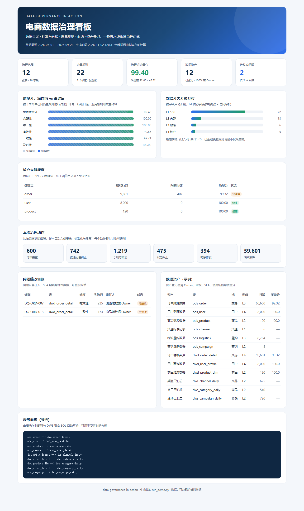

# 数据治理实战：电商数仓从 0 到 1

> 一个可以直接跑起来的数据治理项目：**数据目录 / 数据标准 / 分类分级 / 数据血缘 / 质量规则 / 清洗标准化 / 资产登记 / 治理看板**，覆盖数据治理工程师岗位的核心职责。

[](https://github.com/Ganqi-pp/data-governance-in-action/actions/workflows/ci.yml)


## 这个项目解决什么问题

电商业务里常见的数据问题：

- 订单重复推送、状态码值五花八门，GMV 口径各算各的；
- 手机号、地址散落在各表，没人说得清哪些字段敏感、该怎么脱敏；
- 报表出错只能靠人肉排查，不知道字段从哪来、改了下游会不会炸；
- 数据质量靠"感觉"，没有可量化、可追踪的指标。

本项目用一套可运行的流水线，把这些问题变成**可配置、可巡检、可闭环**的治理动作：

```
模拟业务数据（含 8 类典型缺陷）
      ↓
ODS 贴源层 → 清洗 / 标准化 / 脱敏 → DWD 明细层 → SQL 聚合 → DWS 汇总层
      ↓                ↓                  ↓
  元数据采集        质量规则引擎        数据血缘解析
      ↓                ↓                  ↓
  数据目录        质量报告 + 整改台账      影响分析
      ↓
  数据资产登记 + 治理看板（单文件 HTML）
```

## 核心能力

| 能力 | 实现 | 产物 |
| --- | --- | --- |
| 数据目录 / 元数据 | 自动采集表结构、行数，合并业务元数据与字段中文名 | `reports/data_catalog.md` |
| 数据标准 | 命名、类型、码值、元数据完备性四类检查 | `reports/standard_check.md` |
| 分类分级 | 字段级 L1—L4 识别 + 脱敏规则 + 权限要求 | `reports/data_catalog.md`、`docs/05` |
| 数据血缘 | 清洗作业配置 + DWS 聚合 SQL 解析，输出 Mermaid 图 | `reports/lineage.md` |
| 数据质量 | 22 条规则、5 个维度、治理前后双跑、行级质量分 | `reports/quality_report.md` |
| 清洗标准化 | 去重、码值统一、时序修复、脱敏、分层标记 | `dwd_*` / `dws_*` 表 |
| 数据资产 | 12 项资产登记（Owner/密级/SLA/场景/质量分） | `reports/asset_register.csv` |
| 治理看板 | 单文件 HTML，离线可看，可直接截图 | `reports/dashboard.html` |

## 与岗位 JD 的对应关系

| JD 职责 | 本项目对应实现 |
| --- | --- |
| 建立数据治理体系、制度流程和责任机制 | `docs/01` 治理章程、`docs/02` 标准管理办法、`docs/03` RACI 责任矩阵 |
| 组织数据目录、元数据、数据标准、分类分级和数据血缘建设 | `src/dgov/metadata.py`、`standards.py`、`classify.py`、`lineage.py` |
| 制定数据质量规则，开展监测评估、问题定位和整改验收 | `config/quality_rules.json`、`src/dgov/quality.py`、问题台账与样本定位 |
| 推进数据清洗、标准化转换、治理平台配置及数据资产登记 | `src/dgov/cleanse.py`、`assets.py`、`reports/asset_register.csv` |
| 沉淀治理方法、质量报告和行业模板 | `docs/` 六份制度文档 + 月报模板 + 可复用的规则/资产配置 |

## 快速开始

```bash
git clone https://github.com/Ganqi-pp/data-governance-in-action.git
cd data-governance-in-action

# 仅依赖 Python 3.10+ 标准库，无需安装第三方包
python run_demo.py
```

约 15 秒后生成：

- `reports/dashboard.html` —— 治理看板（浏览器直接打开）
- `reports/quality_report.md` —— 治理前后质量对比与整改台账
- `reports/data_catalog.md` —— 12 张表、96 个字段的字段级数据字典
- `reports/standard_check.md` —— 标准违规清单
- `reports/lineage.md` —— 表级血缘与影响分析
- `reports/asset_register.csv` —— 数据资产登记清单

## 运行结果（可复现）

| 指标 | 结果 |
| --- | --- |
| 纳管表 / 字段 | 12 张 / 96 个 |
| 数据量 | 6 万订单、8 千用户、3.8 万物流单 |
| 质量规则 | 22 条，覆盖完整性、唯一性、有效性、一致性、及时性 |
| 治理前质量分 | **92.88** |
| 治理后质量分 | **99.40** |
| 修复问题 | 去重 600、码值纠正 742、手机号修复 1,219、状态纠正 475、时序修复 394 |
| 遗留问题 | 2 项（渠道未知、商品不可关联），已进入整改台账 |
| 敏感字段 | 11 个（L3/L4），全部配置脱敏规则 |

## 作品展示



- 治理看板：`reports/dashboard.html`
- 质量报告：`reports/quality_report.md`
- 数据目录：`reports/data_catalog.md`
- 标准检查：`reports/standard_check.md`
- 数据血缘：`reports/lineage.md`

## 项目结构

```
data-governance-in-action/
├─ run_demo.py                 # 一键跑通全流程
├─ config/                     # 治理配置（标准/规则/分级/资产/业务元数据）
├─ sql/                        # 建表 DDL 与 DWS 聚合 SQL
├─ src/dgov/                   # 治理引擎
│  ├─ seed_data.py             # 造数 + 缺陷注入
│  ├─ metadata.py              # 元数据与数据目录
│  ├─ standards.py             # 标准检查
│  ├─ classify.py              # 分类分级
│  ├─ lineage.py               # 血缘解析
│  ├─ quality.py               # 质量规则引擎与评分
│  ├─ cleanse.py               # 清洗与标准化
│  ├─ assets.py                # 资产登记
│  └─ report.py                # 治理看板
├─ docs/                       # 章程/办法/RACI/指标字典/安全规范/操作手册/月报
├─ reports/                    # 运行产物（已提交示例结果）
└─ tests/                      # 单元测试
```

## 测试

```bash
python -m unittest discover -s tests -v
```

## 技术栈

Python 3.10+（标准库）、SQLite、SQL（窗口函数/聚合）、HTML/CSS、GitHub Actions。

## Roadmap

- [ ] 接入 DataHub / Atlas，替换本地元数据存储
- [ ] 质量规则支持自定义 SQL 与跨表一致性校验
- [ ] 血缘扩展到字段级，支持列级影响分析
- [ ] 增加数据服务 API 与权限网关示例

## 作者

佟钰鹏 · 数据科学与大数据技术 · 2027 届

## License

MIT
