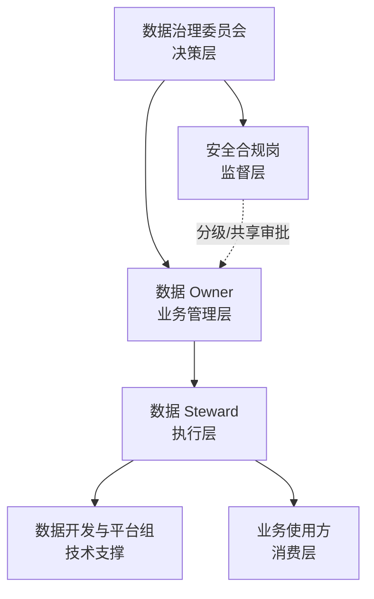

# 数据治理体系与组织

> 适用范围：雄安新区市场服务部市场主体登记、信用评价、企业诉求三类数据。
> 本文回答四个问题：**为什么治、谁来治、治什么、怎么持续治。**

## 1. 背景与目标

市场主体服务的数据散落在登记系统、公共信用平台、12345 热线三个来源：同一家企业可能在三个系统里名称不一致、信用代码校验不过、联系电话缺失、诉求正文还夹带身份证号。业务侧的直接感受是：

- 想给企业打电话，号码是 `138-1234-5678`、`+8613812345678` 或全角数字，系统识别不了；
- 想看信用等级，发现等级和评分对不上；
- 想做诉求分析，正文里的个人信息不敢直接给第三方；
- 报表出了问题，不知道字段从哪来、改了下游会不会受影响。

治理目标按“一年打基础、三年成体系”设计：

| 阶段 | 目标 |
| --- | --- |
| 首年（本项目） | 3 张核心表 100% 纳管；标准、目录、分级、质量、血缘、资产六项基础能力跑通；质量健康度 ≥ 90 |
| 三年 | 核心数据质量 ≥ 95；共享接口 100% 脱敏；资产运营与考核机制成熟；接入 DataHub / Atlas 与调度平台 |

## 2. 治理原则

1. **业务主导**：数据 Owner 对数据内容和共享范围负最终责任，技术团队不替业务做“哪些字段可以共享”的决定。
2. **标准先行**：没有标准字段、码表和口径，不做清洗；否则只是把错误从一张表搬到另一张表。
3. **源头治理**：能在源系统修的不在下游修；下游只做校验、隔离和补全，并把问题回传源系统。
4. **分级保护**：先分类分级，再谈共享；个人信息最小必要、脱敏优先、访问留痕。
5. **以用促治**：以市场主体活跃率、诉求办结率等真实指标为牵引，不做“为治理而治理”的台账。
6. **可度量、可验收**：每个问题有规则、有主键、有 Owner、有 SLA、有复检结论。

## 3. 治理组织

| 角色 | 定位 | 核心职责 |
| --- | --- | --- |
| 数据治理委员会 | 决策层 | 审定战略、制度、年度计划；裁决跨部门争议；听取季度报告 |
| 数据 Owner | 业务管理层 | 对数据准确性、完整性、共享范围负最终责任；确认整改与验收 |
| 数据 Steward | 执行层 | 维护标准、元数据、规则、资产台账；组织定位、跟踪、复检 |
| 数据开发与平台组 | 技术支撑 | 实现采集、清洗、脱敏、血缘、看板；保障任务稳定与变更可追溯 |
| 安全合规岗 | 监督层 | 审核分类分级、共享审批、个人信息保护措施；组织风险评估 |
| 业务使用方 | 消费层 | 按授权使用；反馈口径与质量问题；不得擅自复制或转供 |

组织不是“挂名”。本项目把每个角色的责任写进了机器可读的 [`config/governance.json`](../config/governance.json)，资产台账里的 Owner、规则里的 Owner、工单里的 Owner 必须能对上。

## 4. RACI 责任矩阵

> R = 负责执行，A = 最终批准，C = 需咨询，I = 需知会。

| 流程 | R | A | C | I |
| --- | --- | --- | --- | --- |
| 数据标准立项与发布 | 数据 Steward | 数据治理委员会 | 数据 Owner、安全合规岗 | 数据开发与平台组 |
| 质量问题发现与工单派发 | 数据 Steward | 数据 Owner | 数据开发与平台组 | 业务使用方 |
| 问题整改与验收 | 源系统责任部门 | 数据 Owner | 数据 Steward | 数据治理委员会 |
| 分类分级与共享审批 | 数据 Steward | 安全合规岗 | 数据 Owner | 数据治理委员会 |
| 数据资产登记与变更 | 数据 Steward | 数据 Owner | 数据开发与平台组 | 业务使用方 |
| 血缘变更影响分析 | 数据开发与平台组 | 数据 Steward | 数据 Owner | 业务使用方 |

## 5. 制度体系（1 + N）

**1 个总纲**：《数据治理章程》——明确目标、组织、职责、决策机制和考核原则。

**N 个专项办法**：

| 制度 | 解决什么问题 | 本项目对应 |
| --- | --- | --- |
| 数据标准管理办法 | 字段怎么定义、怎么评审、怎么落标 | `config/standards.json`、`docs/02` |
| 数据质量管理办法 | 规则怎么定、问题怎么派、怎么验收 | `config/quality_rules.json`、`docs/04` |
| 数据分类分级管理办法 | 数据怎么分级、谁能用、怎么脱敏 | `config/classification_rules.json`、`docs/03` |
| 数据资产管理办法 | 什么算资产、怎么登记、怎么运营 | `config/assets.json`、`docs/06` |
| 数据共享管理办法 | 谁能申请、怎么审批、怎么审计 | `docs/03`、`docs/06` |
| 数据安全与个人信息保护细则 | 个人信息识别、影响评估、事件响应 | `docs/03` |

制度不追求“厚”，追求“每条都能执行”。例如质量办法不写“加强质量管理”，而写“高严重度问题 3 个工作日内反馈计划，超期升级到数据 Owner”。

## 6. 五条运行流程

### 6.1 标准立项与落标

1. 业务提出字段需求，Steward 检索是否已有标准可复用；
2. 跨部门共享字段提交委员会评审，安全合规岗评估个人信息风险；
3. 更新 `standards.json` 并递增版本，记录变更说明；
4. 开发按标准建表/改表，CI 执行 `standards.py` 检查，失败阻断发布；
5. 每季度抽样核对标准与实现的一致性。

### 6.2 质量监测与工单

1. 每日/每月按规则扫描，生成问题清单（规则、主键、证据、Owner、SLA）；
2. Steward 按严重度和影响行数排序，派发工单；
3. 源系统责任部门在 SLA 内反馈计划；
4. 超期未处理升级到数据 Owner；连续两月未整改提交委员会；
5. 修复后由 Steward 复检，通过才关闭工单。

### 6.3 分类分级与共享审批

1. 新增字段先定分类、级别、个人信息标识；
2. L3/L4 字段默认不共享；确需共享的，说明目的、范围、期限、接收方；
3. 安全合规岗审批，选择脱敏策略；
4. 共享出口做残留扫描，保留访问日志；
5. 每季度复核授权清单，目的完成后删除或匿名化。

### 6.4 资产登记与运营

1. 系统上线或数据产品发布前 5 个工作日登记；
2. 登记要素包括 Owner、Steward、级别、共享属性、更新频率、质量分、血缘；
3. 未登记不得共享；连续 6 个月无访问的资产经 Owner 确认后归档；
4. 每季度按使用频次、支撑业务数、质量分、共享收益评估价值。

### 6.5 变更影响分析

1. 字段新增/删除/重命名/口径变更前，执行 `python run_demo.py impact <field>`；
2. 输出直接涉及表、下游表、受影响指标/接口/报告；
3. 通知下游 Owner，约定变更窗口；
4. 变更后重跑质量与指标回归，确认无断链。

## 7. 考核指标（首年）

| KPI | 首年目标 | 三年目标 | 口径 |
| --- | ---: | ---: | --- |
| 核心数据质量达标率 | ≥ 90% | ≥ 95% | 记录级健康度加权 |
| 质量问题处置率 | ≥ 85% | ≥ 90% | （修复 + 隔离 + 容差内观察）÷ 治理前问题 |
| 数据资产登记完整率 | 100% | 100% | 登记要素齐全的资产 ÷ 全部资产 |
| 分类分级覆盖率 | 100% | 100% | 已分级字段 ÷ 纳管字段 |
| 共享接口脱敏覆盖率 | 100% | 100% | 残留检测为 0 的接口 ÷ 共享接口 |
| 核心表字段级血缘覆盖率 | 100% | 100% | 有字段映射的标准字段 ÷ 标准字段 |

> 目标不是一开始就定 95%。首年先把“能测、能改、能验收”跑通，再逐步抬高目标；否则容易出现“为了达标而删数据”。

## 8. 落地路线图

| 阶段 | 时间 | 重点 | 交付物 |
| --- | --- | --- | --- |
| 0—1 月 | 启动 | 组织、制度、范围、基线 | 章程、RACI、数据目录、质量基线 |
| 1—3 月 | 打基础 | 标准、清洗、隔离、资产登记 | 29 字段标准、44 条规则、资产台账 |
| 3—6 月 | 补短板 | 分类分级、共享脱敏、血缘 | 分级清单、共享接口、字段级血缘 |
| 6—12 月 | 常态化 | 工单闭环、考核、月报 | 月度治理报告、KPI 看板、整改复盘 |
| 12 月+ | 扩展 | 接平台、扩域、智能化 | DataHub/Atlas、更多识别器、趋势分析 |

## 9. 本项目如何落地这套体系

| 体系要素 | 代码/配置 | 产物 |
| --- | --- | --- |
| 组织与 RACI | `config/governance.json` | 本文、治理月报 |
| 标准 | `config/standards.json`、`src/dgov/standards.py` | `reports/standard_check.md` |
| 质量 | `config/quality_rules.json`、`src/dgov/quality.py` | `reports/quality_report.md`、`issue_register.csv` |
| 分类分级 | `config/classification_rules.json`、`src/dgov/classify.py` | `reports/classification_report.md` |
| 资产 | `config/assets.json`、`src/dgov/assets.py` | `reports/asset_register.md` |
| 血缘 | `config/transformations.json`、`config/lineage.json`、`src/dgov/lineage.py` | `reports/lineage.md` |
| 指标 | `config/metrics.json`、`src/dgov/metrics.py` | `reports/metrics.md`、驾驶舱 |

这套体系可以复用到其他政务数据域：替换标准、码表、规则和造数脚本，保留组织、流程、评分和报告框架即可。
