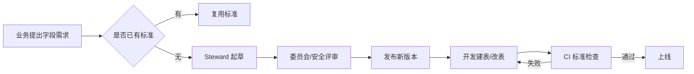

# 数据标准规范

> 标准是治理的“度量衡”。没有字段标准，清洗就只是把错误从一张表搬到另一张表。
> 本文说明本项目的标准体系、命名规则、核心字段标准、码表、落标流程和版本管理。

## 1. 标准体系

本项目采用“**1 个数据标准 + 3 类配套**”的结构：

```text
数据标准（standards.json）
├─ 基础标准：命名、类型、长度、可空、默认值
├─ 业务标准：字段中文名、定义、口径、取值范围
├─ 技术标准：主键、业务键、码表引用、更新频率
└─ 管理标准：Owner、Steward、标准编号、版本、生效日期
```

标准不是只给开发看的。业务能看懂“这个字段是什么意思”，开发能据此建表，质量规则能据此校验，资产台账能据此登记。

## 2. 命名规范

| 对象 | 规则 | 示例 |
| --- | --- | --- |
| 表名 | 小写下划线，分层前缀 + 业务名 | `ods_market_register`、`dwd_complaint_case` |
| 字段名 | 小写下划线，见名知义 | `unified_social_credit_code` |
| 主键 | `<业务>_id` | `reg_id`、`rating_id`、`case_id` |
| 时间字段 | 以 `_time` 结尾，日期以 `_date` 结尾 | `update_time`、`reg_date` |
| 金额字段 | 带单位后缀 | `reg_capital_wan`（万元） |
| 布尔字段 | `is_` / `has_` 前缀 | `is_valid` |
| 禁用 | `tmp_`、`test_`、`bak_` 前缀；拼音缩写；无意义编号 | - |

分层前缀约定：

| 前缀 | 含义 | 本项目 |
| --- | --- | --- |
| `ods_` | 贴源层，保留原始值 | 3 张表 |
| `dwd_` | 明细层，完成清洗与标准化 | 3 张表 |
| `dws_` | 指标/汇总层 | 由 `metrics.json` 生成 |
| `ref_` | 参考码表 | 区划、行业、状态、信用等级 |
| `dim_` | 维度表（预留） | - |

## 3. 数据类型与长度

| 类型 | 说明 | 示例 |
| --- | --- | --- |
| `string` | 文本，按字符计长度 | 企业名称 100 |
| `integer` | 整数 | 满意度 1—5 |
| `number` | 小数，声明 precision/scale | 注册资本 18,2 |
| `date` | `YYYY-MM-DD` | 注册日期 |
| `datetime` | `YYYY-MM-DD HH:MM:SS` | 更新时间 |
| `boolean` | 0/1 或 true/false | 是否有效 |

约定：

- 日期统一存储为 ISO 格式，禁止 `2024/13/40`、`2024.05.12` 这类“看起来像日期”的字符串进入明细层；
- 手机号统一 11 位、去分隔符、去 `+86`；
- 金额统一万元、两位小数；
- 码值统一使用码表代码，不存中文别名（展示层再翻译）。

## 4. 核心字段标准（节选）

| 标准编号 | 表.字段 | 中文名 | 类型 | 约束 | 说明 |
| --- | --- | --- | --- | --- | --- |
| GOV-REG-001 | market_register.reg_id | 登记流水号 | string(32) | 主键、非空 | 登记系统唯一流水号 |
| GOV-REG-002 | market_register.unified_social_credit_code | 统一社会信用代码 | string(18) | 唯一、非空、GB 32100 校验 | 18 位，含校验位 |
| GOV-REG-003 | market_register.company_name | 企业名称 | string(100) | 非空 | 登记机关核准全称 |
| GOV-REG-004 | market_register.reg_date | 注册日期 | date | 非空、不得晚于截止日 | 营业执照成立日期 |
| GOV-REG-005 | market_register.reg_capital_wan | 注册资本（万元） | number(18,2) | ≥ 0 | 保留两位小数 |
| GOV-REG-006 | market_register.industry_code | 行业代码 | string(4) | 引用行业码表 | GB/T 4754-2017 |
| GOV-REG-007 | market_register.district_code | 行政区划代码 | string(6) | 引用区划码表 | 县级/功能区 |
| GOV-REG-008 | market_register.address | 住所 | string(200) | 非空 | 精确到门牌号 |
| GOV-REG-009 | market_register.legal_person | 法定代表人 | string(50) | 非空、个人信息 | 姓名 |
| GOV-REG-010 | market_register.contact_phone | 联系电话 | string(20) | 手机号格式、个人信息 | 11 位 |
| GOV-REG-011 | market_register.contact_email | 电子邮箱 | string(100) | 邮箱格式、个人信息 | 小写存储 |
| GOV-REG-012 | market_register.status | 经营状态 | string(10) | 枚举 5 值 | 存续/在业/注销/吊销/迁出 |
| GOV-REG-013 | market_register.update_time | 更新时间 | datetime | 非空 | 源系统最后更新时间 |
| GOV-CRE-003 | credit_rating.credit_score | 信用评分 | integer | 0—100 | 百分制 |
| GOV-CRE-004 | credit_rating.credit_level | 信用等级 | string(1) | A/B/C/D | 与分数区间一致 |
| GOV-CASE-005 | complaint_case.content | 诉求内容 | string(2000) | 非空、个人信息 | 共享前必须脱敏 |
| GOV-CASE-008 | complaint_case.satisfaction | 满意度 | integer | 1—5 或空 | 未回访为空 |
| GOV-CASE-009 | complaint_case.close_time | 办结时间 | datetime | 已办结必填、≥ 提交时间 | 流转日志为准 |

完整 29 个字段见 [`config/standards.json`](../config/standards.json) 与自动生成的 [`reports/data_catalog.md`](../reports/data_catalog.md)。

## 5. 码表管理

| 码表 | 来源 | 本项目管理 |
| --- | --- | --- |
| 行政区划 | 民政部门 | 河北省 + 雄安新区 + 容城/安新/雄县，`ref_administrative_divisions` |
| 行业分类 | GB/T 4754-2017 | 雄安常见行业子集，`ref_industry_codes` |
| 经营状态 | 登记业务 | 存续/在业/注销/吊销/迁出 |
| 信用等级 | 信用评价办法 | A/B/C/D，对应 90/75/60 分界 |

码表管理规则：

1. 码表只增不改；确需修改的，新增版本并保留旧版本；
2. 业务系统不得自定义“正常”“在营”等别名，别名由清洗层映射；
3. 码表变更须同步质量规则与资产台账；
4. 每季度与权威源核对一次，差异记录在案。

## 6. 标准编号与版本

标准编号格式：`GOV-<域>-<序号>`，例如 `GOV-REG-002`。

| 域 | 含义 |
| --- | --- |
| REG | 市场主体登记 |
| CRE | 信用评价 |
| CASE | 企业诉求 |

版本规则：

- 字段新增：次版本号 +1（1.0.0 → 1.1.0）；
- 字段类型/长度/码值变更：主版本号 +1（1.1.0 → 2.0.0），必须做影响分析；
- 仅修正描述/错别字：修订号 +1（1.0.0 → 1.0.1）。

`standards.json` 当前版本 `1.0.0`，生效日期 `2026-10-01`。

## 7. 落标流程



本项目把“落标检查”做成了 46 项自动检查，覆盖：

- 标准表是否存在、字段是否齐全、是否有未登记字段；
- 表名/字段名是否符合命名规范；
- 字段中文名、类型、说明、标准编号是否完整；
- 表级 Owner、Steward、更新频率是否完整；
- 主键是否声明且存在；
- 行业、区划等码表引用是否可解析；
- 实际最大长度是否超过标准长度。

运行结果：[`reports/standard_check.md`](../reports/standard_check.md)。当前 46 项检查通过 44 项，符合率 **95.7%**；两项低严重度失败都是原始数据中的缺陷值（行业名称 16 字符、信用等级 4 字符）触发的长度告警，正好说明“标准检查能发现落标问题”。

## 8. 标准与质量、资产、血缘的联动

| 联动对象 | 机制 |
| --- | --- |
| 质量规则 | 每条规则声明 `standard_ref`，规则失败可追溯到标准条款 |
| 资产登记 | 字段级标准编号进入数据目录，资产可按标准检索 |
| 血缘 | 字段映射必须覆盖全部标准字段，CI 校验映射完整性 |
| 分类分级 | 标准字段声明后必须补分类、级别、个人信息标识，否则资产不能登记 |

标准不是一份静态文档，而是一组被代码、规则、报告同时引用的“契约”。这也是本项目与“写一份标准文档”最大的区别。
