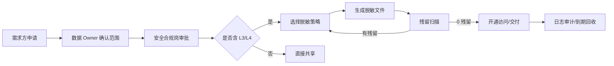

# 数据分类分级与个人信息保护

> 依据《数据安全法》《个人信息保护法》、GB/T 43697-2024《数据安全技术 数据分类分级规则》、GB/T 35273-2020《信息安全技术 个人信息安全规范》。
> 本项目把“分级”做成字段规则，“识别”做成内容扫描，“保护”做成脱敏导出与共享审批。

## 1. 为什么要做分类分级

市场主体数据看起来“都是企业信息”，但实际上混杂了自然人信息：

- 法定代表人姓名、联系电话、邮箱是个人信息；
- 12345 诉求正文里可能出现身份证号、银行卡号，属于敏感个人信息；
- 企业住所聚合后可能定位到具体经营场所，不宜无条件公开。

如果不分级，常见后果是：该共享的没共享、不该共享的整表外发；出了事无法证明“采取了必要措施”。分类分级是数据共享的前置条件，不是事后补的文档。

## 2. 分级定义

| 级别 | 名称 | 定义 | 管控要求 | 本项目字段数 |
| :---: | --- | --- | --- | ---: |
| L1 | 公开数据 | 可依法公开、可无条件共享 | 发布前做一致性校验，保留发布记录 | 7 |
| L2 | 内部数据 | 仅限部门内部使用，泄露影响业务但不涉及个人权益 | 按需授权，禁止外传；跨部门共享需审批 | 18 |
| L3 | 敏感数据 | 含个人信息或企业敏感经营信息 | 最小必要、脱敏共享、访问留痕、定期复核 | 4 |
| L4 | 核心数据 | 泄露可能危害国家安全、公共利益或造成严重后果 | 专库加密、双人授权、禁止出域、全量审计 | 0（字段级）；内容扫描可识别 |

> 表级按最高字段级别定：`market_register` 与 `complaint_case` 为 L3，`credit_rating` 为 L2。

## 3. 分类主题域

| 分类 | 名称 | 典型字段 | 主要用途 |
| --- | --- | --- | --- |
| C01 | 市场主体基础信息 | 信用代码、企业名称、注册日期、注册资本、行业、区划、住所、状态 | 登记、统计、共享 |
| C02 | 联系人信息 | 法定代表人、联系电话、邮箱 | 企业服务、触达 |
| C03 | 信用评价信息 | 评分、等级、评级日期、评级机构 | 信用监管、分级分类监管 |
| C04 | 企业诉求信息 | 工单编号、类型、提交时间、正文、承办部门、状态、满意度 | 诉求办理、营商环境分析 |
| C05 | 数据治理信息 | 更新时间、质量标记 | 内部运维 |

字段级完整清单见 [`reports/classification_inventory.csv`](../reports/classification_inventory.csv)，共 29 个字段，覆盖率 100%。

## 4. 识别方法：字段规则 + 内容扫描

### 4.1 字段级

按“表 + 字段”配置分类、级别、是否个人信息、是否敏感、脱敏策略。例如：

| 字段 | 分类 | 级别 | 个人信息 | 脱敏 |
| --- | :---: | :---: | :---: | --- |
| `unified_social_credit_code` | C01 | L1 | 否 | 不脱敏（依法公示） |
| `address` | C01 | L2 | 否 | 保留到区县 |
| `legal_person` | C02 | L3 | 是 | 张* |
| `contact_phone` | C02 | L3 | 是 | 138****5678 |
| `contact_email` | C02 | L3 | 是 | z***@example.com |
| `content` | C04 | L3 | 是（潜在敏感） | 按内容识别结果替换 |

### 4.2 内容级

只看字段名不够。`content` 字段名叫“诉求内容”，里面却可能有身份证号。项目用 4 类识别器扫描 1,500 条工单正文：

| 识别器 | 类型 | 级别 | 正则要点 | 命中行数 | 检出率 |
| --- | --- | :---: | --- | ---: | ---: |
| PII-MOBILE | 手机号 | L3 | `1[3-9]` + 9 位，前后不能是数字 | 37 | 100% |
| PII-IDCARD | 身份证号 | L4 | 18 位，出生日期合法，末位可为 X | 37 | 100% |
| PII-EMAIL | 邮箱 | L3 | 本地部分 + 域名 + 后缀 | 37 | 100% |
| PII-BANKCARD | 银行卡号 | L4 | 62 开头，16—19 位 | 39 | 100% |

合计命中 **150 行**、150 处（每行注入一类），与造数清单完全一致。报告见 [`reports/classification_report.md`](../reports/classification_report.md)，逐条命中见 [`reports/pii_findings.csv`](../reports/pii_findings.csv)（样例已脱敏）。

为什么不用“只靠字段名”？因为字段名可以骗人：叫 `remark` 的字段可能全是身份证号；叫 `content` 的字段也可能干净。字段级负责“已知”，内容级负责“未知”。

## 5. 脱敏策略

| 策略 | 规则 | 示例 |
| --- | --- | --- |
| 姓名脱敏 | 保留姓氏，其余 `*` | 张* |
| 手机号脱敏 | 保留前 3 后 4 | 138****5678 |
| 邮箱脱敏 | 保留首字符 + 域名 | z***@example.com |
| 身份证脱敏 | 保留前 3 后 4 | 130***********1234 |
| 银行卡脱敏 | 仅保留后 4 位 | ************1234 |
| 地址脱敏 | 保留到区县，门牌号替换 | 河北省雄安新区容城县*** |
| 正文脱敏 | 按识别结果替换四类个人信息 | 联系电话 138****5678 |

共享导出后再次全文扫描，当前 **残留 0 处**（目标 0）。这比“配置了脱敏规则”更有说服力：规则可能没生效，残留扫描不会骗人。

## 6. 共享审批

审批要点：

1. 目的是否明确、是否最小必要；
2. 接收方是否具备安全能力、是否签署使用承诺；
3. 共享字段是否已脱敏、是否仍有重识别风险；
4. 期限、撤回条件、删除义务是否写明；
5. 日志是否保留不少于 3 年。

## 7. 个人信息保护影响评估（PIA）要点

| 评估项 | 本项目情况 | 措施 |
| --- | --- | --- |
| 处理目的 | 企业服务、信用监管、诉求办理 | 目的限定，不用于无关营销 |
| 处理方式 | 采集、清洗、共享 | 最小必要；共享脱敏 |
| 信息类型 | 姓名、电话、邮箱、正文潜在证件号 | 分级 L3/L4；内容扫描 |
| 保存期限 | 登记永久、诉求 5 年 | 到期归档/删除 |
| 主体权利 | 查询、更正、删除 | 建立受理渠道与台账 |
| 安全措施 | 访问控制、脱敏、审计 | 授权最小化、日志留存 |
| 风险 | 重识别、二次传播 | 脱敏 + 承诺书 + 到期回收 |

## 8. 安全事件响应（简版）

1. **发现**：监控告警、共享方反馈、内部审计；
2. **止损**：暂停接口、收回权限、隔离数据；
3. **评估**：涉及人数、信息类型、可能后果；
4. **报告**：按法规要求向主管部门报告，必要时通知个人；
5. **复盘**：定位原因、修补规则、更新分级与授权；
6. **记录**：事件台账保留不少于 3 年。

## 9. 当前边界

- 分级规则是“字段 + 正则”的规则引擎，不能替代法律判断；实际落地需安全合规岗逐字段确认；
- 内容识别只覆盖四类高价值个人信息，地址、车牌、护照号等尚未覆盖；
- 脱敏是静态文件级，未实现 API 动态脱敏与行列级权限；
- 共享审批是流程示例，未接真实 OA/权限系统。

这些边界已写入 [`docs/09`](09-运行手册与复盘.md)，是下一阶段的优先事项。
