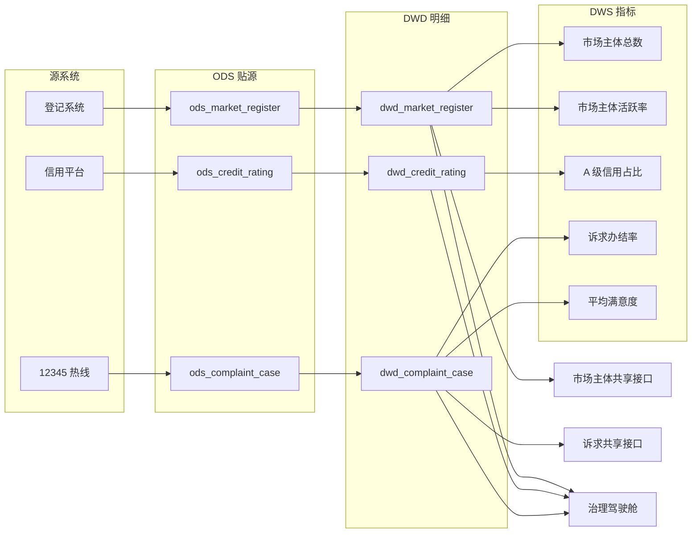

# 元数据与数据血缘

> 元数据回答“我有哪些数据、字段是什么意思”；血缘回答“它从哪来、改它会影响谁”。
> 本项目不接 DataHub/Atlas，用 SQLite + 配置把这两件事做到可运行、可解释。

## 1. 元数据分四类

| 类型 | 内容 | 采集方式 | 存放 |
| --- | --- | --- | --- |
| 结构元数据 | 表名、字段名、顺序、类型、行数 | 读取 SQLite 系统表 | `reports/data_catalog.json` |
| 业务元数据 | 中文名、定义、标准编号、Owner、更新频率 | `config/standards.json` | 数据目录、数据字典 |
| 统计元数据 | 空值率、基数、最长值、高频值 | SQL 聚合剖析 | 数据目录 JSON / MD |
| 安全元数据 | 分类、级别、个人信息、脱敏策略 | `config/classification_rules.json` | 分类分级报告 |

管理元数据（Owner、Steward、版本、生效日期）放在标准表级配置中，资产台账再补充共享属性、质量分、血缘上下游。

## 2. 采集结果

当前纳管 6 张表、61 个字段：

| 层级 | 表 | 行数 | 字段数 | 说明 |
| --- | --- | ---: | ---: | --- |
| ODS | `ods_market_register` | 1,240 | 13 | 登记原始数据 |
| ODS | `ods_credit_rating` | 950 | 7 | 信用评价原始数据 |
| ODS | `ods_complaint_case` | 1,500 | 9 | 诉求工单原始数据 |
| DWD | `dwd_market_register` | 1,139 | 14 | 清洗后主数据（含修复标记） |
| DWD | `dwd_credit_rating` | 901 | 8 | 清洗后信用评价 |
| DWD | `dwd_complaint_case` | 1,443 | 10 | 清洗后工单 |

29 个业务字段在标准中 100% 有中文名、类型、说明和标准编号；DWD 层额外增加 `dq_flags` 记录修复动作。

数据目录中每个字段还包含：

- 空值率：例如 `contact_phone` 治理前 5.2% 为空；
- 基数：例如 `status` 只有 5 个标准值；
- 最长值：用于判断是否超过标准长度；
- 高频值：例如行业代码分布。

完整目录见 [`reports/data_catalog.md`](../reports/data_catalog.md)。

## 3. 为什么要做数据剖析

只看字段名，不知道数据“长什么样”。剖析能提前发现：

- 某字段空值率 60%，说明业务没采集，不是清洗能解决的；
- 某字段基数等于行数，可能是主键；
- 某字段最长值 16，但标准长度 4，说明有非标准值混入；
- 某字段高频值出现“正常/在营/开业”，说明需要码值映射。

本项目把剖析结果直接写进数据目录，作为标准检查和规则设计的输入。

## 4. 血缘模型



### 4.1 表级血缘

节点分为源系统、ODS、DWD、DWS、共享/服务、治理六层；边带转换说明（T+1 抽取、清洗、指标计算、脱敏共享）。

### 4.2 字段级血缘

字段映射不是手写文档，而是来自 [`config/transformations.json`](../config/transformations.json)。例如：

| 源表.字段 | 目标表.字段 | 转换规则 |
| --- | --- | --- |
| `ods_market_register.contact_phone` | `dwd_market_register.contact_phone` | 去分隔符、+86、全角转半角，校验后置空 |
| `ods_market_register.district_code` + `address` | `dwd_market_register.district_code` | 按住所县名修正区划 |
| `ods_credit_rating.credit_score` + `credit_level` | `dwd_credit_rating.credit_level` | 按评分区间重算等级 |
| `ods_complaint_case.content` | `dwd_complaint_case.content` | 保留原文，共享时按识别结果脱敏 |

当前共 31 条字段级映射，覆盖全部 DWD 业务字段。`dq_flags` 是派生字段，不参与业务血缘。

## 5. 变更影响分析

命令：

```bash
python run_demo.py impact contact_phone
```

输出包括：

- 直接涉及表：`ods_market_register`、`dwd_market_register`；
- 表级下游：市场主体共享接口、治理驾驶舱等；
- 影响资产：市场主体共享接口（脱敏）；
- 建议：同步修改手机号标准、质量规则 `DQ-REG-010`、脱敏策略、共享接口字段说明。

另一个例子：`status` 变更会影响：

- 市场主体活跃率、市场主体总数、诉求办结率指标；
- 治理驾驶舱；
- 市场主体共享接口；
- 状态码相关质量规则。

### 变更流程

1. 提交变更申请，说明字段、原因、影响范围；
2. 执行 `impact`，生成受影响资产清单；
3. 通知下游 Owner，约定变更窗口；
4. 修改转换配置、标准、规则、指标 SQL；
5. 重跑全流程与回归测试；
6. 更新血缘图与资产台账，记录变更日志。

## 6. 血缘治理规则

1. 新增字段必须同时更新 `transformations.json` 与 `lineage.json`；
2. 字段级映射覆盖率纳入 CI 检查；
3. 删除/重命名字段前必须做影响分析；
4. 指标口径变更必须同步 `metrics.json`；
5. 共享接口字段变更必须经安全合规岗复核；
6. 每季度核对血缘与实际加工逻辑，发现漂移 5 个工作日内修复。

## 7. 当前边界

- 血缘来自配置声明，不是从 SQL 自动解析；优点是可控、可读，缺点是需要人工维护；
- 只做到字段级，未做到列级表达式级（如 `CASE WHEN` 分支）追踪；
- 未接调度系统，无法自动感知任务依赖变化；
- 影响分析基于表级拓扑 + 字段依赖，可能高估影响范围（宁多勿漏）。

下一阶段可接 DataHub/Atlas，把配置导入图数据库，实现自动解析与可视化。
