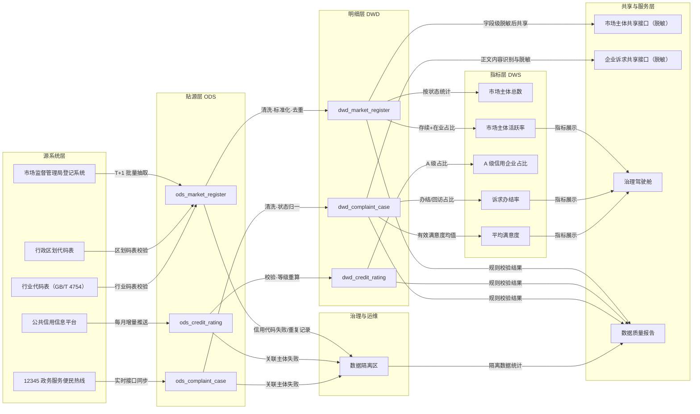

# 数据血缘与影响分析报告

> 血缘由转换配置与指标依赖自动生成，表级拓扑用于变更评审，字段级映射用于影响分析。

## 一、表级血缘

## 二、字段级血缘（示例）

| 源表 | 源字段 | 目标表 | 目标字段 | 转换规则 |
| --- | --- | --- | --- | --- |
| `ods_market_register` | `district_code` | `dwd_market_register` | `district_code` | 按住所中的县级行政区名修正区划代码 |
| `ods_market_register` | `address` | `dwd_market_register` | `district_code` | 按住所中的县级行政区名修正区划代码 |
| `ods_market_register` | `contact_phone` | `dwd_market_register` | `contact_phone` | 去分隔符与 +86、全角转半角，按手机号规则校验；不合规置空 |
| `ods_market_register` | `status` | `dwd_market_register` | `status` | 同义词映射为标准状态码；无法映射置空 |
| `ods_credit_rating` | `credit_level` | `dwd_credit_rating` | `credit_level` | 去空格转大写；按分数区间重算标准等级 |
| `ods_credit_rating` | `credit_score` | `dwd_credit_rating` | `credit_level` | 去空格转大写；按分数区间重算标准等级 |
| `ods_complaint_case` | `content` | `dwd_complaint_case` | `content` | 去首尾空白；保留原文供内部办理，共享时按内容识别结果脱敏 |
| `ods_complaint_case` | `status` | `dwd_complaint_case` | `status` | 同义词映射为标准状态码；无法映射保留原值 |

## 三、变更影响分析

### 变更：`contact_phone` — 手机号标准由 11 位调整为支持固话

- 预期影响：市场主体共享接口、企业服务触达清单、质量规则 DQ-REG-010；
- 直接涉及表：`dwd_market_register`, `ods_market_register`；
- 下游表：`dwd_market_register`, `ods_market_register`, `quarantine`；
- 影响资产：市场主体共享接口（脱敏）。

### 变更：`status` — 经营状态码表新增“歇业”

- 预期影响：市场主体活跃率、治理驾驶舱、共享接口；
- 直接涉及表：`dwd_complaint_case`, `dwd_market_register`, `ods_complaint_case`, `ods_market_register`；
- 下游表：`dwd_complaint_case`, `dwd_market_register`, `ods_complaint_case`, `ods_market_register`, `quarantine`；
- 影响资产：市场主体总数, 市场主体活跃率, 诉求办结率。

## 四、血缘治理规则

1. 新增字段必须同时更新 `config/transformations.json` 与 `config/lineage.json`，CI 校验映射完整性；
2. 删除/重命名字段前必须执行影响分析，通知下游资产 Owner 并保留变更窗口；
3. 指标口径变更须同步更新 `config/metrics.json`，并重跑回归；
4. 共享接口字段变更须经安全合规岗复核，确认脱敏策略仍然有效；
5. 每季度核对一次血缘与实际加工逻辑，发现漂移在 5 个工作日内修复。
