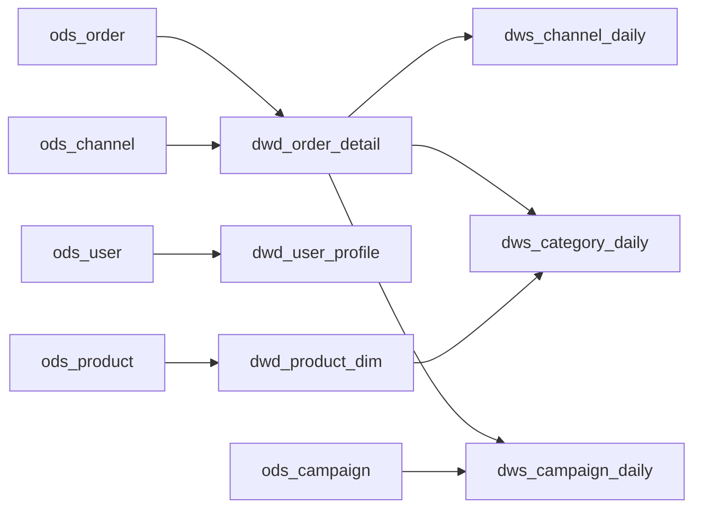

# 数据血缘（表级）

| 上游 | 下游 | 加工方式 |
| --- | --- | --- |
| `ods_order` | `dwd_order_detail` | 清洗作业：去重、码值标准化、时序校验、脱敏 |
| `ods_user` | `dwd_user_profile` | 清洗作业：手机号标准化、姓名/邮箱脱敏、会员分层 |
| `ods_product` | `dwd_product_dim` | 清洗作业：价格校验、类目补全 |
| `ods_channel` | `dwd_order_detail` | 码值映射：渠道编码标准化 |
| `dwd_order_detail` | `dws_channel_daily` | SQL 聚合：按日期/维度汇总 |
| `dwd_order_detail` | `dws_category_daily` | SQL 聚合：按日期/维度汇总 |
| `dwd_product_dim` | `dws_category_daily` | SQL 聚合：按日期/维度汇总 |
| `dwd_order_detail` | `dws_campaign_daily` | SQL 聚合：按日期/维度汇总 |
| `ods_campaign` | `dws_campaign_daily` | SQL 聚合：按日期/维度汇总 |

## 影响分析示例

- 修改 `ods_order.order_status` 码值 → 影响 `dwd_order_detail` 状态标准化、`dws_channel_daily` 支付/退款口径；
- 下线 `ods_channel` → 影响渠道码值映射与渠道日报，需提前通知数据分析组；
- 调整 `dwd_user_profile.phone` 脱敏规则 → 影响用户触达与合规审计，需走变更审批。